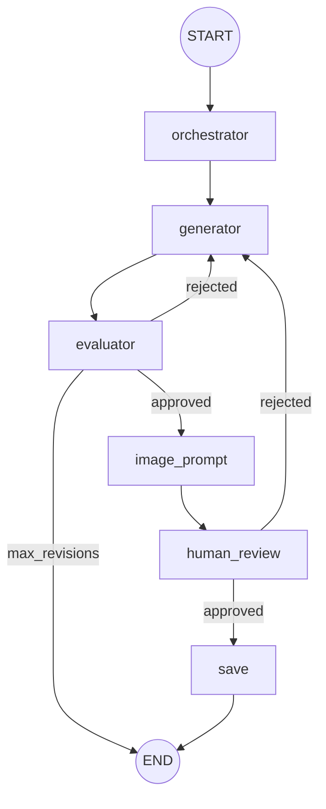

# Article Creation dengan LangGraph

> **Catatan:** repo ini adalah **proyek latihan** untuk belajar LangGraph, bukan proyek produksi.
> Kodenya sengaja dibuat sederhana dan penuh komentar (bahasa Indonesia) agar mudah dipelajari,
> dan bisa berubah sewaktu-waktu seiring proses belajar.

Pipeline multi-agent yang membuat artikel blog dari satu topik. Beberapa agent LLM bekerja bergantian
(membuat outline, menulis, menilai), lalu **manusia** memberi persetujuan akhir sebelum artikel
disimpan sebagai file Markdown.

## Yang dipelajari di proyek ini

- State bersama antar node (`TypedDict`) dan *partial update*
- Node dan edge, termasuk **conditional edge** dengan fungsi router
- Loop revisi (evaluator menolak, generator menulis ulang) dengan batas iterasi
- Output terstruktur dari LLM (`with_structured_output` + Pydantic)
- **Checkpointer** SQLite dan `thread_id`
- **Streaming** per node (`stream_mode="updates"`)
- **Human-in-the-loop** dengan `interrupt()` dan `Command(resume=...)`

## Alur workflow



| Node | Fungsi |
|---|---|
| `orchestrator` | LLM membuat outline dari topik |
| `generator` | LLM menulis artikel Markdown (atau merevisinya jika ada feedback) |
| `evaluator` | LLM menilai artikel dan memutuskan `approved` atau tidak |
| `image_prompt` | LLM membuat prompt gambar cover dari artikel |
| `human_review` | Graph berhenti dan menunggu jawaban Anda (`y`/`n`) |
| `save` | Menyimpan hasil ke `output/` sebagai file `.md` |

Jika Anda menjawab `n` saat persetujuan, Anda bisa menulis catatan perbaikan (opsional), lalu artikel
ditulis ulang dan ditanyakan lagi sampai disetujui.

## Cara menjalankan

Perintah di bawah untuk Windows.

```bash
python -m venv .venv
.venv\Scripts\activate
pip install -r requirements.txt
```

Buat file `.env` di root proyek:

```
OPENROUTER_API_KEY=isi-key-anda
OPENROUTER_MODEL=nama-model-di-openrouter
# Opsional
OPENROUTER_BASE_URL=https://openrouter.ai/api/v1
OUTPUT_LANGUAGE=Indonesian
```

Jalankan:

```bash
python main.py
```

Program menanyakan topik artikel, menampilkan progres tiap node, lalu meminta persetujuan Anda.
Artikel yang disetujui disimpan di `output/` berisi catatan (topik, outline, prompt gambar) lalu artikelnya.

Melihat riwayat checkpoint run lama (tanpa memanggil LLM):

```bash
python main.py <thread_id>
```

## Struktur folder

```
main.py              titik masuk: menjalankan graph, streaming, approval
agents/              satu class per agent (memanggil LLM)
graph/               state, nodes, router, workflow
prompts/             template prompt
services/            penyimpanan file hasil
models/              model Pydantic (EvaluationResult)
config/              pengaturan (.env) dan pembuat LLM
tests/               skrip uji mandiri (bukan pytest)
docs/index.html      dokumentasi interaktif (buka di browser)
```

## Tes

Tiap file di `tests/` adalah skrip mandiri yang mencetak hasil. Jalankan dari root proyek:

```bash
python -m tests.test_human_review
```

Tes yang memakai agent palsu (tanpa LLM): `test_router`, `test_storage`, `test_checkpointer`,
`test_sqlite_checkpointer`, `test_streaming`, `test_human_review`.
Tes yang memanggil LLM sungguhan (butuh `.env` aktif): `test_evaluator`, `test_generator`, `test_image_prompt`.

## Dokumentasi interaktif

Setelah clone atau download repo ini, buka `docs/index.html` di browser untuk melihat diagram
workflow yang bisa diklik, simulator alur, penjelasan tiap agent, dan cuplikan kode beranotasi.
(File HTML tidak ditampilkan sebagai halaman di GitHub, jadi perlu dibuka dari komputer.)
